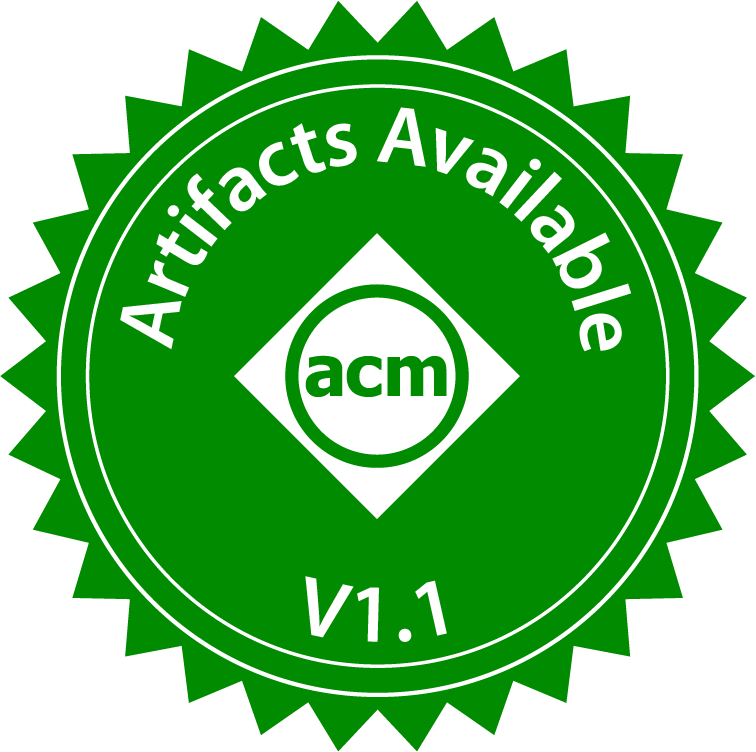
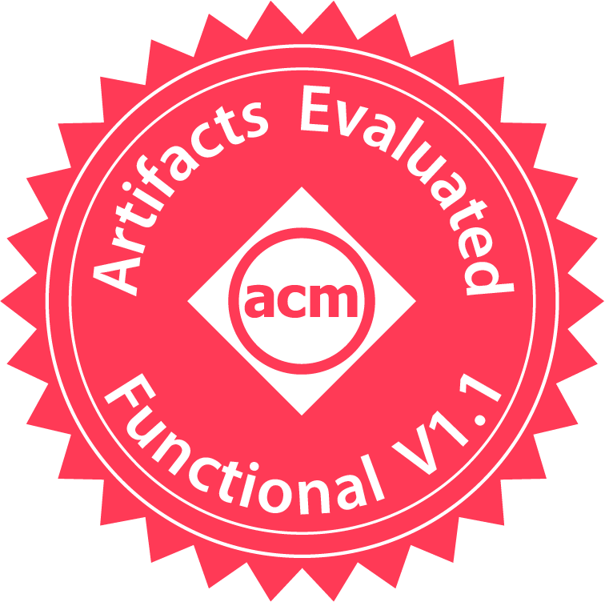
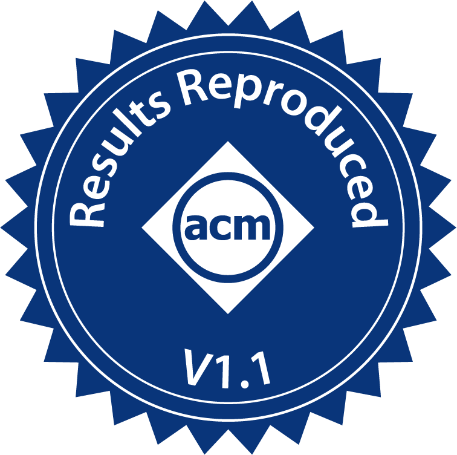
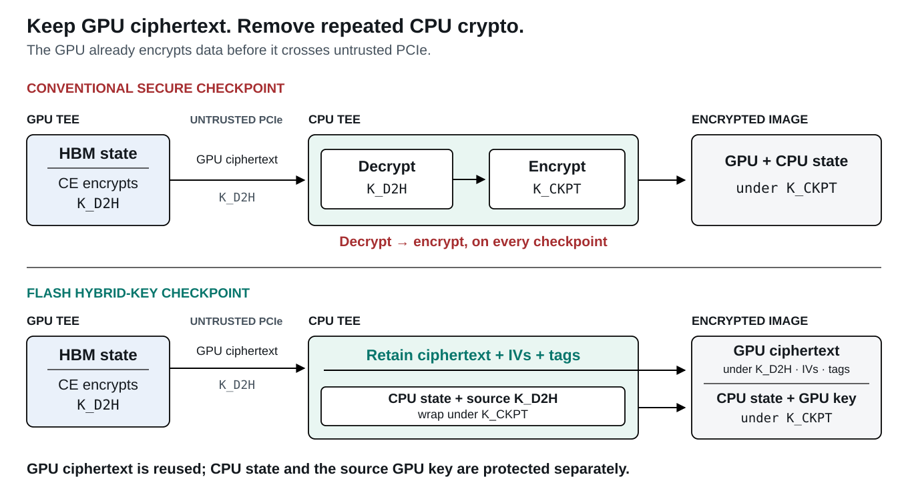
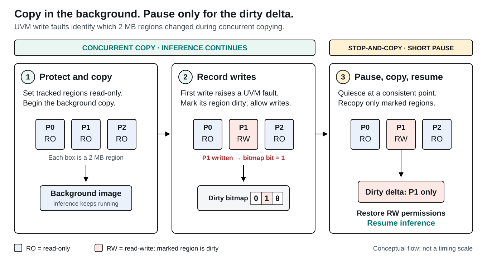
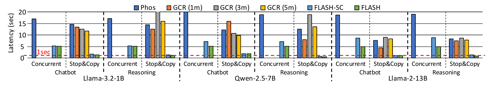

# FLASH

**Fault-Led, Attested, Secure Hybrid-Key Checkpoint for Confidential Inference**

**ACM SIGOPS ATC 2026**

Jonghyun Lee, Taewoon Kang, Yongqin Wang, Rachit Rajat, Mengyuan Li, Gunjae Koo, Daniel Wong, and Murali Annavaram.

[](docs/flash-atc2026.pdf) [](https://doi.org/10.5281/zenodo.23199897) [](LICENSE) [](https://verifiable.pro/)

FLASH is a **GPU checkpoint/restore system for confidential LLM inference** on **NVIDIA H100 and Intel TDX**. It saves encrypted GPU data, including the key-value (KV) cache, while vLLM continues serving requests. A hybrid-key checkpoint format avoids redundant CPU cryptography, and UVM write faults identify the pages that must be copied during the final pause.

<p>
  <a href="https://sysartifacts.github.io/atc2026/results"></a>
  <a href="https://sysartifacts.github.io/atc2026/results"></a>
  <a href="https://sysartifacts.github.io/atc2026/results"></a>
</p>

Awarded **Artifacts Available**, **Artifacts Evaluated — Functional**, and **Results Reproduced** in the [ATC 2026 artifact evaluation](https://sysartifacts.github.io/atc2026/results).

[Design](#how-flash-checkpoints-encrypted-gpu-state) · [Results](#checkpoint-latency-results) · [Setup and reproduction](#getting-started) · [Repository guide](#repository-guide) · [Citation](#citation) · [Research links](#research-and-presentation)

## Why checkpointing confidential inference is difficult

Long-running LLM sessions accumulate valuable KV cache state. Losing that state forces a cold restart and repeated computation. GPU confidential computing protects the model and its state from an untrusted host, but also makes saving that state expensive: GPU memory must leave the device encrypted over PCIe.

A conventional secure checkpoint decrypts the arriving GPU data on the CPU, then encrypts it again under a checkpoint key. Copying the full GPU footprint while serving is paused compounds this cost. In the paper's H100 measurements, confidential-mode transfer bandwidth falls from about **40 GB/s to 7.3 GB/s**; transferring 80 GB alone takes roughly **11 seconds**, before the additional checkpoint encryption.

FLASH addresses both sources of overhead: it retains the GPU's ciphertext and reduces how much data must be copied during the pause.

## How FLASH checkpoints encrypted GPU state

### 1. Keep the GPU's ciphertext in the checkpoint



*Hybrid-key checkpointing. The same GPU ciphertext crosses PCIe and enters FLASH's checkpoint image; CPU state and the source GPU key use a separate protection domain. Redrawn from paper Figure 4.*

The GPU copy engine (CE) already encrypts device-to-host transfers. FLASH retrieves that ciphertext, its initialization vectors (IVs), and authentication tags through a custom driver IOCTL. It stores them directly in the image, avoiding the CPU decrypt-then-reencrypt cycle on the checkpoint path. CPU state and the GPU decryption key are protected separately under the checkpoint key. Restore reconstructs the source decryption context before moving data into the destination GPU's protected memory.

### 2. Track dirty GPU pages while serving continues



*Concurrent checkpointing with UVM dirty tracking. Most copying overlaps with inference; the final pause captures pages modified during the tracking window. Redrawn from paper Figure 5.*

FLASH interposes on CUDA allocations to bring them under Unified Virtual Memory (UVM) control. During concurrent copying, it uses read-only permissions and write faults to record modified memory at **2 MB granularity**. Once the background copy finishes, FLASH pauses the workload, copies the dirty pages, and resumes serving. Tracking happens in the driver, without modifying LLM kernels or requiring offline PTX analysis.

### 3. Capture static allocations once

Model weights usually remain unchanged after loading. In the paper's design, FLASH learns which allocations stay static across checkpoint intervals and reuses their saved data in subsequent checkpoints. Static pages remain write-protected: a later write promotes the affected region to the dynamic set. Recovery still restores both static and dynamic state. The released agent provides static classification through `v3-static`; its default uses host-to-device allocation flags, while learning is enabled separately with `--learn`.

The paper's security protocol protects checkpoint confidentiality, integrity, and freshness using attestation and a trusted remote service for key release and freshness records. See [Section 6 of the paper](docs/flash-atc2026.pdf#page=8) for the trust assumptions and security analysis.

## Checkpoint latency results



*Paper Figure 6. Concurrent copying overlaps with inference; stop-and-copy is the phase that pauses serving. Lower stop-and-copy bars mean shorter interruptions.*

The paper evaluates a **single H100 in confidential computing mode with Intel TDX and vLLM 0.8.5**. It covers three models under short-context Chatbot and long-context Reasoning workloads, with checkpoint images staged in DRAM-backed tmpfs.

| Reported metric | Result |
| --- | --- |
| Mean stop-and-copy latency, summarized across FLASH and FLASH-SC | **1.2 s** |
| Stop-and-copy latency reduction relative to the PhoenixOS-based comparison (PhOS) | **9.4×** |
| Stop-and-copy latency reduction relative to GCR at a 1-minute checkpoint interval | **7.8×** |

**FLASH-SC** is the ablation without static allocation classification. PhOS and GCR are reimplementations of the published systems' checkpoint data paths on the same confidential stack; their original artifacts do not run unchanged on this platform. The numbers above are paper-reported results. Serving impact varies by workload; see Section 7 for TTFT/TBT distributions and the high-concurrency Llama-1B case.

## Getting started

### Required environment

This artifact depends on a confidential GPU setup and a modified kernel driver. The documented evaluation environment is:

| Component | Configuration |
| --- | --- |
| GPU | NVIDIA H100, 80 GB, confidential computing enabled; DevTools mode disabled |
| Host | Intel TDX 1.5 on Ubuntu 25.04 |
| Guest | Ubuntu 24.04; 64 vCPUs, 300 GB RAM, 300 GB disk in the documented VM configuration |
| Driver and toolkit | NVIDIA **550.163.01** for both userspace and kernel modules; CUDA **12.4** |
| Inference framework | vLLM **0.8.5** |
| Build dependencies | C/C++ toolchain, matching kernel headers, OpenSSL development headers (`libssl-dev`) |

The H100 must be passed through to the TDX guest. Driver installation and benchmarks run **inside that guest**. Checkpoint staging consumes substantial guest RAM; size the images and `/dev/shm` for the selected experiment using the [buffer preparation instructions](benchmarks/README_BENCHMARK.md#preallocate-checkpoint-buffers). A larger tmpfs limit does not add physical memory.

### Step 1: Clone the artifact and install the driver

The detailed guides use `artifact_flash` as the checkout directory name:

```bash
git clone https://github.com/sept-usc/FLASH.git artifact_flash
cd artifact_flash
```

Follow [Installing FLASH's modified NVIDIA driver](modified_driver_code/README_SETUP.md) to configure the confidential VM, install the pinned CUDA/driver versions, apply the UVM changes, and reboot. The guide specifies the working directory for each step.

After installation, run this from the repository root:

```bash
sudo ./modified_driver_code/verify_driver.sh
```

**Expected result:** every check reports `PASS`, including the installed and loaded FLASH module, driver version, CE channel pool, and UVM persistence mode.

### Step 2: Check the transfer path

After applying the [per-boot system settings](benchmarks/README_BENCHMARK.md#system-settings), run the bandwidth microbenchmarks. These do not require model downloads or the large checkpoint images. From the repository root:

```bash
make -C benchmarks/table1_bandwidth
(
  cd benchmarks/table1_bandwidth
  ./memory_transfer_benchmark_sync  | tee table1_sync.log
  ./memory_transfer_benchmark_async | tee table1_async.log
)
```

The programs print host-to-device and device-to-host transfer measurements; logs are saved in `benchmarks/table1_bandwidth/`. To reproduce the confidential/non-confidential comparison in Table 1, run the same binaries in both environments as described in the benchmark guide.

### Step 3: Run checkpoint experiments

Follow [Running FLASH's benchmarks](benchmarks/README_BENCHMARK.md) for buffer preparation, Python dependencies, model downloads, and the two-terminal workload/checkpoint workflow. Llama model downloads require Hugging Face access approval and authentication.

| Paper result | Experiment |
| --- | --- |
| Table 1 | Synchronous and asynchronous host/device bandwidth |
| Figure 3 | Dirty data rate during LLM serving |
| Figure 6 | Concurrent-copy and stop-and-copy latency |
| Figure 7 | Dirty memory copied during stop-and-copy |
| Table 4 | Concurrent-copy duration relative to the full tracking window |

The serving experiments compare PhOS, GCR, FLASH-SC, and FLASH with the model/workload configurations in paper Table 2. The guide provides commands for collecting measurements; it does not include a one-command plot-generation pipeline.

## Repository guide

| Path | Contents |
| --- | --- |
| [`modified_driver_code/`](modified_driver_code/) | UVM modifications for NVIDIA driver 550.163.01, patch application script, and driver verification |
| [`benchmarks/flash/`](benchmarks/flash/) | Checkpoint and restore agents, CUDA interposition libraries, and the vLLM serving benchmark |
| [`benchmarks/phos_emul/`](benchmarks/phos_emul/) | PhoenixOS-based concurrent checkpoint comparison |
| [`benchmarks/gcr_emul/`](benchmarks/gcr_emul/) | GCR-based incremental checkpoint comparison |
| [`benchmarks/table1_bandwidth/`](benchmarks/table1_bandwidth/) | Host/device transfer microbenchmarks |
| [`benchmarks/bandwidth_breakdown/`](benchmarks/bandwidth_breakdown/) | Confidential-mode copy-path decomposition |
| [`benchmarks/prealloc/`](benchmarks/prealloc/) | Checkpoint image and staging-buffer preallocation |
| [`benchmarks/download.sh`](benchmarks/download.sh) | Model and ShareGPT dataset downloads |
| [`docs/flash-atc2026.pdf`](docs/flash-atc2026.pdf) | Final paper and evaluation details |
| [`docs/figures/`](docs/figures/) | Editable SVG diagrams, PNG exports, and the original latency plot |
| [`docs/verifiable-pro/`](docs/verifiable-pro/) | English and Chinese FLASH explainer drafts for verifiable.pro |

## Scope and limitations

The released artifact targets **single-GPU inference on H100 with UVM** and the pinned software stack above. It checkpoints inference data state; GPU execution context is rebuilt by reinitializing the serving framework during recovery. Restoring framework metadata is specific to the serving integration.

The paper's threat model trusts the CPU/GPU TEEs, the guest software that performs checkpoint/restore, and the remote attestation service. It does not guarantee availability against a malicious host or hide checkpoint size, access patterns, or timing. See Sections 3 and 6 for the full model. This repository provides the driver changes and evaluation programs; deploying the paper's complete remote attestation and key-release service requires additional integration.

## Citation

```bibtex
@inproceedings{2026:flash:lee,
  author    = {Jonghyun Lee and Taewoon Kang and Yongqin Wang and
               Rachit Rajat and Mengyuan Li and Gunjae Koo and
               Daniel Wong and Murali Annavaram},
  title     = {{FLASH}: Fault-Led, Attested, Secure Hybrid-Key Checkpoint
               for Confidential Inference},
  booktitle = {The 2026 ACM SIGOPS Annual Technical Conference},
  series    = {SIGOPS ATC '26},
  year      = {2026},
  publisher = {Association for Computing Machinery},
  doi       = {10.1145/3828523.3857076}
}
```

The evaluated artifact is archived at [Zenodo, DOI: 10.5281/zenodo.23199897](https://doi.org/10.5281/zenodo.23199897).

## License

The FLASH code is [MIT licensed](LICENSE). Files derived from NVIDIA's `open-gpu-kernel-modules` retain their original dual **MIT / GPL-2.0** license. The paper and its figures are licensed under **CC BY 4.0**; the two redesigned diagrams adapt the paper's mechanisms. See [figure provenance](docs/figures/README.md), [ACM badge sources](docs/badges/README.md), and [brand asset sources](docs/brand/README.md).

## Research and presentation

<p>
  <a href="https://septlab.com/"></a>
  &nbsp;&nbsp;&nbsp;
  <a href="https://verifiable.pro/"></a>
</p>

Explore systems security research at [SEPT Lab](https://septlab.com/) and research explanations about verifiable AI at [verifiable.pro](https://verifiable.pro/).

**Presented by verifiable.pro** · Read the FLASH explainer draft in [English](docs/verifiable-pro/en.md) or [中文](docs/verifiable-pro/zh.md).
